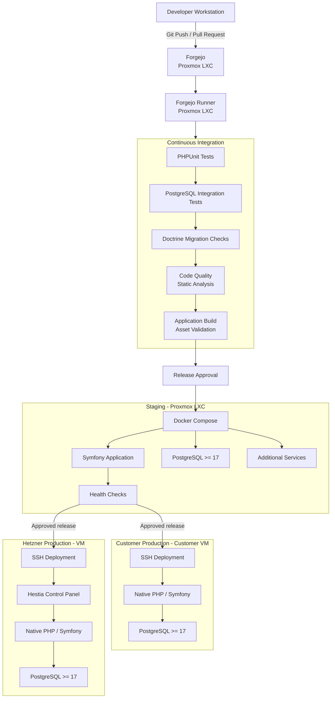
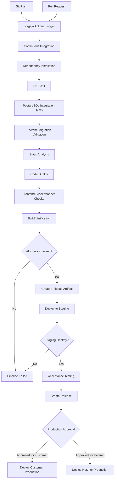
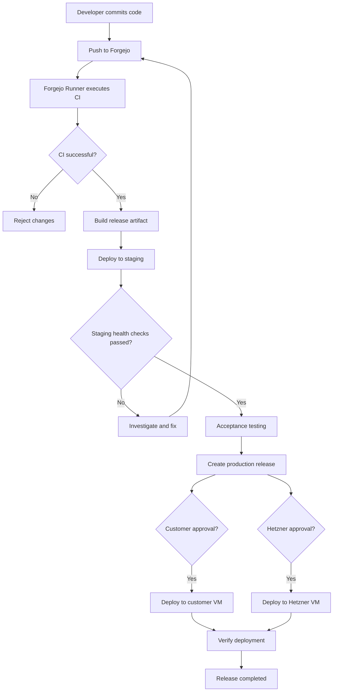

# Full CI/CD Infrastructure for Symfony Application

**File:** `prompt.md`

## 1\. Role and Objective

Act as a Senior DevOps Engineer, Symfony Architect and Infrastructure Engineer.

Your task is to design, implement and document a complete, production-ready CI/CD infrastructure for a Symfony application.

The infrastructure must support three independent environments:

1. Development workstation.
2. Staging environment hosted on Proxmox.
3. Two independent production environments:
   - Customer's virtual machine in the customer's network.
   - Hetzner virtual machine with Hestia Control Panel.

The solution must be secure, maintainable, reproducible and suitable for long-term production use.

Do not assume that all environments have identical configurations. Inspect the existing infrastructure before making architectural decisions.

---

## 2\. Existing Infrastructure

The following infrastructure is already operational in my local network:

- Proxmox VE virtualization platform.
- Forgejo running in a dedicated Proxmox LXC container.
- Forgejo Runner running in a separate Proxmox LXC container.
- Forgejo Runner operates as a system service.
- Runner is already registered with Forgejo.
- Runner is already capable of executing CI jobs.

Important:

- Do not reinstall Forgejo.
- Do not reinstall Forgejo Runner.
- Do not replace existing working configurations without a justified reason.
- First inspect the existing configuration, service status, runner labels, execution environment and capabilities.
- Preserve the current working infrastructure.

---

## 3\. Target Technology Stack

### Backend

- Symfony 8.4 LTS
- PHP version compatible with Symfony 8.4 LTS
- Doctrine ORM
- Doctrine DBAL
- Doctrine Migrations
- PostgreSQL \>= 17

### Frontend

- Twig
- Symfony UX Stimulus
- Symfony UX Turbo
- TailwindCSS
- Symfony AssetMapper

### Infrastructure and CI/CD

- Proxmox VE
- LXC containers
- Forgejo
- Forgejo Actions
- Forgejo Runner
- Docker
- Docker Compose
- SSH
- PHPUnit
- Static analysis and code quality tools

Do not introduce Node.js, Webpack Encore or Vite unless there is a clearly justified technical requirement.

Prefer Symfony-native tooling and AssetMapper.

---

## 4\. Target Infrastructure Architecture

The target architecture is:



### Environment requirements

#### 4.1 Development

- Developer works locally.
- Changes are committed to Git.
- Pushes changes to Forgejo.
- Pull requests trigger CI checks.
- Production deployment is never triggered by an ordinary development push.

#### 4.2 Staging — Proxmox LXC

Staging is a dedicated LXC container running Docker and Docker Compose.

The environment must include:

- Symfony application container.
- PostgreSQL \>= 17 container.
- Additional containers when required.
- Persistent database volumes.
- Persistent application storage where necessary.
- Health checks.
- Logs.
- Environment-specific configuration.

The staging environment must be reproducible and deployable automatically after successful CI.

Docker Compose must be used for staging application and supporting services.

#### 4.3 Customer Production — Customer VM

The customer's production server:

- Is located in the customer's own network.
- Is a virtual machine.
- Is accessible through SSH.
- May already have PHP, PostgreSQL and other services installed.

Requirements:

- Native PHP deployment.
- No Docker.
- No Docker Compose.
- PostgreSQL \>= 17.
- Preserve existing server configuration.
- Do not modify unrelated services.
- Use an appropriate deployment user with limited privileges.
- Respect existing filesystem permissions and service configuration.

Inspect the server before proposing changes.

#### 4.4 Hetzner Production — Hetzner VM with Hestia

The Hetzner production server:

- Is a virtual machine hosted at Hetzner.
- Has Hestia Control Panel installed.
- Is accessible through SSH.

Requirements:

- Native PHP deployment.
- No Docker.
- No Docker Compose.
- PostgreSQL \>= 17.
- Respect Hestia's directory structure, permissions, configuration conventions and service management.
- Avoid changes that interfere with Hestia-managed services.

Inspect the existing configuration before making changes.

---

## 5\. CI/CD Pipeline Architecture

Design the pipeline around Forgejo Actions.

The pipeline must distinguish between CI, staging deployment and production deployment.



### CI requirements

Implement automated checks for:

1. PHP syntax.
2. Composer dependency installation.
3. Composer dependency validation.
4. PHPUnit unit tests.
5. PHPUnit integration tests.
6. PostgreSQL integration.
7. Doctrine schema validation.
8. Doctrine migration validation.
9. Static analysis.
10. Coding standards.
11. Symfony application checks.
12. Twig template validation where applicable.
13. Stimulus and Turbo frontend validation.
14. TailwindCSS and AssetMapper validation.
15. Production build verification.

Use PostgreSQL \>= 17 for database-dependent tests.

Do not rely exclusively on SQLite for testing.

---

## 6\. Database and Doctrine Strategy

Design a consistent database strategy for all three environments.

Requirements:

- PostgreSQL \>= 17.
- Doctrine ORM and DBAL.
- Doctrine Migrations.
- Separate databases and credentials for development, testing, staging and production.
- Reliable migration execution.
- Schema validation.
- Migration testing against an empty database.
- Migration testing against an existing database.
- Backup before production migrations.
- Safe handling of failed migrations.

Test database configuration must be isolated from development and production.

Implement checks to ensure that automated tests cannot accidentally modify production data.

Pay particular attention to transaction handling in PHPUnit and the cleanup of test records.

---

## 7\. Forgejo Runner Configuration

Inspect the existing Runner before changing anything.

Determine:

- Runner version.
- Runner labels.
- Available execution backends.
- Whether Docker-in-Docker or host Docker access is available.
- Network connectivity to Forgejo.
- Network connectivity to staging.
- SSH connectivity to both production environments.
- Available CPU, RAM and storage.
- Security implications of the current execution model.

Recommend a secure Runner architecture.

Do not grant unnecessary access to the Proxmox host.

Do not expose the Docker socket to untrusted jobs without a clear security justification.

Explain how jobs should be separated by trust level and deployment environment.

---

## 8\. Docker Architecture for Staging

Design a production-like staging environment using Docker Compose.

Consider the following structure:

```text
staging/
├── compose.yaml
├── .env
├── docker/
│   ├── php/
│   │   └── Dockerfile
│   └── nginx/
│       └── default.conf
├── app/
└── data/
```

The actual structure may be improved.

Requirements:

- Application container.
- PostgreSQL \>= 17 container.
- Persistent volumes.
- Health checks.
- Internal Docker networking.
- Environment variables and secrets.
- Database initialization.
- Doctrine migrations.
- Logging.
- Restart policies.
- Backup strategy.

Do not expose PostgreSQL publicly unless explicitly required.

Use reproducible container images and pin important versions.

---

## 9\. Native Production Deployment Architecture

Design two independent deployment procedures.

### Customer VM

Use SSH to deploy the application.

Account for:

- Existing PHP installation.
- Required PHP extensions.
- Composer.
- PostgreSQL.
- Web server configuration.
- Filesystem permissions.
- Symfony cache.
- AssetMapper assets.
- Environment variables.
- Doctrine migrations.
- PHP-FPM reloads where appropriate.

### Hetzner VM with Hestia

Use SSH to deploy the application while preserving Hestia's management model.

Account for:

- Hestia-managed domains.
- Document roots.
- PHP versions and PHP-FPM configuration.
- File ownership.
- Web server configuration.
- PostgreSQL.
- SSL certificates.
- Cron jobs.
- Symfony cache.
- AssetMapper assets.

Do not overwrite Hestia-managed configuration blindly.

### Deployment workflow

Design deployment around release directories and an atomic switch where supported.

For example:

```text
/var/www/example/
├── current -> releases/20261124-120000
├── releases/
│   ├── 20261124-120000/
│   └── 20261125-090000/
├── shared/
│   ├── .env.local
│   ├── var/
│   └── uploads/
└── backups/
```

Adapt paths and permissions to the actual hosting environment.

---

## 10\. Release Management

Implement a clear release lifecycle.

Requirements:

- Versioned releases.
- Git tags.
- Release artifacts.
- Deployment history.
- Independent deployment to each production environment.
- Manual production approval.
- Ability to deploy a specific release.
- Ability to roll back application code.
- Database migration compatibility considerations.

Deployment to customer production must not automatically deploy to Hetzner.

Deployment to Hetzner must not automatically deploy to customer production.

Both environments must have independent approval and deployment controls.

---

## 11\. Security and Secrets Management

Design a complete secrets management strategy.

Cover:

- Forgejo Actions secrets.
- SSH private keys.
- Dedicated deployment users.
- SSH known\_hosts verification.
- Database credentials.
- Environment-specific secrets.
- Staging secrets.
- Customer production secrets.
- Hetzner production secrets.
- File permissions.
- Backup encryption.
- Secret rotation.

Never:

- Commit secrets to Git.
- Include secrets in Docker images.
- Print secrets in CI logs.
- Reuse production credentials in staging.
- Use root SSH access for routine deployment without a justified reason.

Use least privilege.

---

## 12\. Backups, Recovery and Rollback

Develop a recovery strategy for all environments.

Cover:

- PostgreSQL backups.
- Backup retention.
- Backup encryption.
- Off-site backup storage.
- Application uploads.
- Configuration backups.
- Restore testing.
- Migration failure handling.
- Application rollback.
- Database recovery.

Explain the difference between rolling back application code and rolling back database schema changes.

Do not assume database migrations can always be reversed safely.

Define a recovery procedure for each production environment independently.

---

## 13\. Monitoring, Logging and Health Checks

Design a practical monitoring solution.

Include:

- Application health endpoint.
- Database connectivity checks.
- Deployment verification.
- Symfony logs.
- PHP-FPM logs.
- Web server logs.
- PostgreSQL logs.
- Docker container health checks in staging.
- Deployment notifications.
- Failure notifications.

Avoid introducing unnecessarily complex monitoring infrastructure.

Recommend tools appropriate for the scale of this project.

---

## 14\. Repository and Workflow Structure

Propose a maintainable repository structure.

Consider:

```text
project/
├── .forgejo/
│   └── workflows/
│       ├── ci.yaml
│       ├── staging.yaml
│       ├── customer-production.yaml
│       └── hetzner-production.yaml
│
├── docker/
│   ├── php/
│   └── nginx/
│
├── deploy/
│   ├── staging/
│   ├── customer/
│   └── hetzner/
│
├── docs/
│   ├── architecture.md
│   ├── infrastructure.md
│   ├── ci_cd.md
│   ├── deployment.md
│   ├── database.md
│   ├── security.md
│   └── recovery.md
│
├── src/
├── config/
├── migrations/
├── templates/
├── assets/
├── tests/
├── composer.json
└── compose.yaml
```

Adjust the structure to Symfony conventions and the actual project.

Keep environment-specific deployment configuration separated.

Avoid unnecessary duplication between workflows.

Use reusable workflow components where supported by the installed Forgejo version.

Verify actual Forgejo Actions compatibility rather than assuming complete GitHub Actions compatibility.

---

## 15\. Infrastructure Discovery and Audit

Before implementation, inspect the available infrastructure.

### Proxmox and Forgejo

Determine:

- Proxmox version.
- Forgejo version.
- Forgejo Runner version.
- LXC configuration.
- Network topology.
- DNS configuration.
- Storage availability.
- Firewall rules.
- Runner execution capabilities.

### Staging

Determine:

- Whether the staging LXC already exists.
- Operating system.
- CPU and RAM.
- Storage.
- Network address.
- Docker availability.
- SSH availability.

### Customer production

Determine:

- Operating system.
- PHP version.
- Installed extensions.
- PostgreSQL version.
- Web server.
- SSH access.
- Existing application hosting configuration.
- Available storage and backup facilities.

### Hetzner

Determine:

- Operating system.
- Hestia version.
- PHP versions.
- PostgreSQL version.
- Web server configuration.
- Domain configuration.
- SSH access.
- Existing backup configuration.

Do not invent missing infrastructure information.

If access is unavailable, explicitly identify what information is needed and provide commands I can execute.

---

## 16\. Implementation Plan and Execution Rules

Work incrementally, following these stages:

### Phase 1 — Discovery

Inspect the repository and existing infrastructure.

Produce an infrastructure inventory and identify limitations.

### Phase 2 — Architecture

Produce the final architecture, deployment model, security model and implementation plan.

Include Mermaid diagrams.

### Phase 3 — CI Foundation

Configure Forgejo Actions, Runner execution and automated testing.

Verify PostgreSQL \>= 17 integration.

### Phase 4 — Staging

Prepare the Proxmox LXC staging environment.

Implement Docker Compose and automated deployment.

### Phase 5 — Production Deployment

Implement independent SSH deployment procedures for:

- Customer production.
- Hetzner production with Hestia.

### Phase 6 — Release Management

Implement release approval, versioning, deployment history and rollback procedures.

### Phase 7 — Security

Audit secrets, SSH access, permissions, network exposure and Runner isolation.

### Phase 8 — Backup and Recovery

Implement backups and verify restoration procedures.

### Phase 9 — Monitoring

Implement health checks, logging and notifications.

### Phase 10 — Documentation

Document the infrastructure, workflows, deployment procedures and recovery instructions.

### Phase 11 — End-to-End Verification

Verify the complete workflow:



The final architecture must also support deploying to only one production environment without affecting the other.

---

## 17\. Working Rules and Safety Constraints

Follow these rules throughout the project:

1. Do not start by generating all configuration files at once.
2. Inspect before modifying.
3. Do not assume infrastructure details.
4. Do not reinstall working services.
5. Do not overwrite existing configurations without inspecting and backing them up.
6. Do not execute destructive commands without explicit approval.
7. Do not deploy to production without explicit approval.
8. Do not expose production secrets.
9. Do not use production databases for automated tests.
10. Do not make unnecessary changes to Hestia.
11. Do not introduce Docker into production.
12. Do not introduce unnecessary infrastructure complexity.
13. Prefer reproducible, version-controlled configuration.
14. Explain architectural decisions and trade-offs.
15. Verify each implementation stage before proceeding.

When a command requires elevated privileges, explain why.

When a change can interrupt an existing service, identify the risk before execution.

When information is missing, ask for the specific information required rather than guessing.

---

## 18\. Expected Deliverables

At the end of the project, provide:

1. Complete infrastructure architecture.
2. Infrastructure inventory.
3. Forgejo Runner configuration recommendations.
4. Forgejo Actions workflow files.
5. CI test configuration.
6. Docker Compose configuration for staging.
7. Staging deployment scripts.
8. Customer production deployment scripts.
9. Hetzner/Hestia deployment scripts.
10. Database migration strategy.
11. Secrets management configuration.
12. Backup and restoration procedures.
13. Rollback procedures.
14. Monitoring and health checks.
15. Mermaid architecture and workflow diagrams.
16. Complete operational documentation.

All configuration and scripts must be ready for actual use, not merely illustrative examples.

---

## 19\. First Action — Start Here

Do not immediately implement the entire infrastructure.

Start by:

1. Inspecting the current repository.
2. Identifying the application state and Symfony version.
3. Inspecting existing Forgejo and Runner integration.
4. Identifying available infrastructure and network connectivity.
5. Checking whether the required deployment targets are accessible.
6. Producing an infrastructure inventory.
7. Identifying missing information and potential risks.
8. Presenting a prioritized implementation plan.

Wait for my approval before making infrastructure changes.

**The ultimate goal is a fully operational CI/CD system connecting the developer workstation, Forgejo, Forgejo Runner, Proxmox staging and two independently deployable production environments.**
